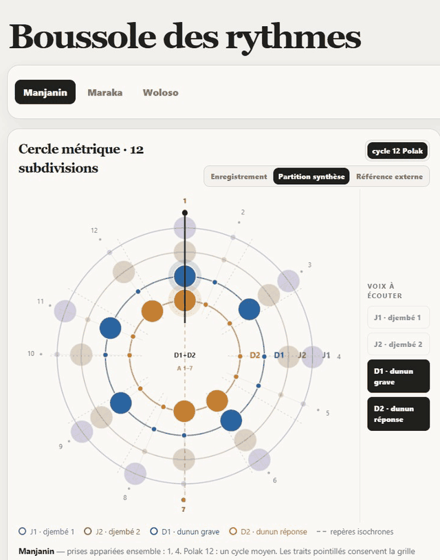

# Djembe: micro-timing analysis and learning experiments on Malian jembe drumming

Analysis of 15 multitrack recordings of Malian jembe ensembles (about 51 minutes, 41,072 annotated strokes), with an audited stroke-level dataset, leakage-safe evaluation and first rhythm-recognition baselines. Generation is in progress.

[](https://colab.research.google.com/github/clementdumeril/Djembe/blob/main/colab/demo_listen_and_explore.ipynb) Listen to the takes, hear the micro-timing against an even grid and open the interactive *Boussole des rythmes*. The corpus is downloaded from OSF into your own Colab session; no audio is stored in this repository.



*The Boussole des rythmes, an interactive page I wrote (French interface): each piece on a 12-pulse circle, with dots at the measured mean positions of the four drums, replayed by its built-in synthesis. Recorded with [`tools/capture_boussole_gif.py`](tools/capture_boussole_gif.py) from a build that contains no corpus audio.*

I started this in June 2026 as a personal project. The data is the IEMP Malian Jembe corpus (Polak, Tarsitani & Clayton, 2018), and it builds on Rainer Polak's doctoral research on jembe drumming in Bamako (Polak, 2004). The question: how much of a rhythm's identity lives in its pattern, and how much in the timing of each stroke? Can a model learn both from such a small corpus? So far the dataset, the evaluation protocol, feature baselines and a first small CNN are done; the CNN does not beat the feature baselines yet.

## Results


| What | Result (balanced accuracy, leave-one-take-out) | Source |
|---|---|---|
| Piece from the whole-take dundun pattern | 15/15 takes for random forest and nearest centroid (exact 95 % CI 0.78 to 1.00) | [`results/step0_rf.json`](results/step0_rf.json) |
| Piece from one cycle of dundun pattern | 0.99 (logistic regression) | [`results/a2_recognition.json`](results/a2_recognition.json) |
| Piece from jembe timing only, pattern masked, 4 cycles | 0.86 (95 % CI 0.74 to 0.95) | [`results/a2_recognition.json`](results/a2_recognition.json) |
| Same, restricted to the tempo range shared by all pieces | 0.87, while tempo alone falls to 0.29 (chance 0.33) | [`results/a2_tempo_control.json`](results/a2_tempo_control.json) |
| Same, tempo regressed out of every feature | 0.78 (95 % CI 0.64 to 0.90) | [`results/a2_tempo_control.json`](results/a2_tempo_control.json) |
| 1D CNN on jembe stroke sequences (which pulses and their timing), 1 / 8 cycles, mean of 3 seeds | 0.78 / 0.74, against 0.77 / 0.89 for logistic regression on the jembe feel | [`results/a3_sequence_cnn_cpu.json`](results/a3_sequence_cnn_cpu.json) |

The whole-take result is a ceiling: the three dundun patterns differ so much that a nearest-centroid rule already separates them. The more informative result is the jembe timing. With the pattern masked, the timing of the jembe strokes on the three pulses of each beat still identifies the piece in 77 % (1 cycle) to 89 % (8 cycles) of windows. This holds inside a tempo band where tempo alone carries no information, and survives, about 9 points lower, when tempo is regressed out.


The jembe *pattern* (which pulses are played) is at or below chance for short windows. My working hypothesis: takes differ more by who plays which part than pieces do, so the classifier learns take-specific habits that do not transfer to the held-out take. The worst take for the timing features is Manjanin_1 (about 25 % of its windows correct); I have not found out why yet.

## What I built

- [`djembe_dataset.py`](djembe_dataset.py): downloads the annotations from OSF and builds one event table. Each row is one stroke: take, instrument, player, cycle, subdivision, onset, peak amplitude, offset from the even grid (fraction of a pulse and ms), musical section. Every experiment reads only this table.
- [`splits.json`](splits.json), [`tests/`](tests/): frozen leave-one-take-out folds and 9 tests (25 cases). They fail if a take ends up on both sides of a split, if a window spans two takes, or if a file's take label disagrees with its name.
- [`features.py`](features.py), [`recognition_baselines.py`](recognition_baselines.py): windows of 1 to 8 cycles and five feature sets (tempo, dundun pattern, jembe pattern, jembe timing per pulse, jembe feel per position in the beat), scored with majority class, nearest centroid, logistic regression and random forest.
- [`tempo_control.py`](tempo_control.py): the two tempo controls above.
- [`sequence_models.py`](sequence_models.py): a 1D CNN (11k parameters) and a transformer (68k parameters) on stroke sequences, same folds and metrics. The CNN has been run on CPU; the transformer is too slow there and runs on Colab.
- [`colab/demo_listen_and_explore.ipynb`](colab/demo_listen_and_explore.ipynb) and [`demo_audio.py`](demo_audio.py): a listening demo. Each piece is played, then its dundun with a click on the even 12-pulse grid, then the analysis and the Boussole, all computed in the reader's session.
- [`colab/`](colab/): the same pipelines on Google Colab. Pinned dependencies, GPU detection with CPU fallback, the corpus downloaded into the session, outputs written to Google Drive.
- Analysis notebooks `01` to `07` (dundun extraction, tempo and accelerando, micro-timing, Fourier fingerprint of the 12-pulse pattern) and [`boussole_rythmes_V2.py`](boussole_rythmes_V2.py), a self-contained interactive page that draws each rhythm on a 12-pulse circle with its complex Fourier coefficients.
- Earlier experiments in `archive/` (informed NMF source separation, a YouTube recognition test, a second-order Markov generator with measured swing). Their outputs are stripped and none of them has a proper evaluation.

## How it works

The corpus annotates every metric position of every cycle: 12 pulses per row of the metre file. Each stroke is placed relative to its cycle:

```
phase = (onset - cycle_start) / cycle_duration
offset = phase - (pulse - 1) / 12          (fraction of a cycle; x12 for pulses, x duration for ms)
```

An offset of zero means an isochronous grid. Polak's work showed that this music is not isochronous: the three pulses of a beat are not equally long. The "feel" features summarise that directly. For each position in the beat (1st, 2nd, 3rd pulse), they take the mean and spread of the jembe offsets over the four beats of the window, so which pulses are played does not enter.

Two details of the table: the last cycle of each take has no end time, so its 43 strokes have no offset; and 1,422 strokes (3.5 %) sit more than half a pulse from their nominal position, which I keep as annotated. Woloso's metre file labels half-cycles (`1.1`, `1.2`) whose dundun figures differ, which is why its averaged pattern shows probabilities around 0.5.

## How I checked it

- **Data audit.** The OSF file `MJ_Maraka_5_Onsets_Selected.csv` actually contains take Woloso_5: its own `Take` column says so, and its dundun onsets match the raw Woloso_5 onsets (98.6 % within 10 ms) but not the Maraka_5 ones (9.9 %, about chance). Woloso_5 has no file of its own. My earlier analyses used these files and reported 12/14 for the take-level classifier; both errors trace back to this mix-up. The event table reads the `_Onsets_Selected_Peak` files, which are correct for all 15 takes. Details and a reproducible check: [`docs/CORPUS_ERRATUM.md`](docs/CORPUS_ERRATUM.md).
- **Leakage.** The split unit is the take, never the stroke, cycle or window. The same dundun player (Madu Jakite) plays on every take, so a split by musician is impossible. An abandoned experiment in `archive/v2_abandonne` used stratified folds over strokes, which mixes strokes of one take between train and test; `iter_folds` now refuses any split that shares a take.
- **Reference points and intervals.** Every score sits next to tempo alone, a majority-class model and a nearest-centroid rule. Intervals come from a bootstrap over takes, stratified by piece, because windows of one take are not independent. For whole-take scores I use an exact binomial interval: over 15 takes, a bootstrap collapses to [1, 1] at perfect accuracy. The majority-class model scores 0 here: removing one take always flips the training majority away from the held-out piece.
- **No tuning on test takes.** All models use fixed settings chosen before running. When hyperparameters start to be tuned, a validation take will be held out inside each training fold.

## Limitations

- 15 takes, 3 pieces, one dundun player, four jembe players in total, all recorded in the same sessions. Results hold within this corpus. They say nothing about other musicians or other rhythms.
- The analysis notebooks `01` to `07` and `utils_V2.py` still read the faulty `_Onsets_Selected` files, so their Maraka and Woloso figures include the mix-up until they are ported to the event table. All results in this README come from the event table.
- The CNN is below the feature baselines, most clearly on long windows, where there are 8 times fewer training windows for the same fixed 40 epochs. Its settings have not been tuned. The transformer has not been evaluated yet, and the generation experiments in `archive/` were judged only by ear.
- The corpus licence (CC BY-NC-ND 4.0) forbids redistributing derived data. The event table, audio and any trained weights stay out of the repository. Only code, fold definitions, aggregate metrics and figures are versioned.

## Next

1. Evaluate the transformer on Colab, and tune both networks (epochs, size) on a validation take held out inside each training fold.
2. Generation: a sequence model over strokes, conditioned on the piece, with a continuous timing head. It will be evaluated with distances between timing distributions per pulse, a check that the model does not copy its training data, and a blind listening test.

## Reproduce

```bash
pip install -r requirements-train.txt
python djembe_dataset.py download     # annotations only, about 10 MB from OSF
python djembe_dataset.py build        # output/events.csv, about 7 s
python djembe_dataset.py splits       # regenerates splits.json (deterministic)
python -m pytest -q tests             # 25 cases, a few seconds
python step0_rf_baseline.py           # results/step0_rf.json, about 20 s on 2 threads
python recognition_baselines.py       # results/a2_recognition.json and figure, several minutes on 2 threads
python tempo_control.py               # results/a2_tempo_control.json, a few minutes
python sequence_models.py --models cnn --out results/a3_sequence_cnn_cpu.json   # about 20 min on 2 threads
python make_figures.py                # docs/figures/
```

On Colab, open `colab/demo_listen_and_explore.ipynb` (listening demo), `colab/00_step0_dataset_baseline.ipynb` or `colab/01_a2_a3_recognition.ipynb` and run all cells. Notebooks are committed without outputs; `tests/test_repo_clean.py` and the pre-commit hook in `.pre-commit-config.yaml` enforce it, because outputs would embed corpus audio. The analysis notebooks and the interactive page need the audio (`python djembe_dataset.py download --audio`, about 900 MB) and the packages in `requirements.txt`. Their French documentation is in [`docs/GUIDE_FR.md`](docs/GUIDE_FR.md).

## Credits

- Corpus: Polak, R., Tarsitani, S., & Clayton, M. (2018). *IEMP Malian Jembe* [Data set]. OSF. https://doi.org/10.17605/OSF.IO/M652X. Licence CC BY-NC-ND 4.0. Recordings, annotated onsets, metre and form annotations are theirs.
- Founding thesis: Polak, R. (2004). *Festmusik als Arbeit, Trommeln als Beruf: Jenbe-Spieler in einer westafrikanischen Großstadt*. Berlin: Dietrich Reimer. ISBN 978-3-496-02771-3. Doctoral thesis, Universität Bayreuth, 2002. https://d-nb.info/971098840
- Collection paper: Clayton, M., et al. (2021). The Interpersonal Entrainment in Music Performance Data Collection. *Empirical Musicology Review, 16*(1), 65–84. https://doi.org/10.18061/emr.v16i1.7555
- Micro-timing findings reproduced in the notebooks: Polak, R. (2010). Rhythmic feel as meter. *Music Theory Online, 16*(4), https://doi.org/10.30535/mto.16.4.4. Polak, R., & London, J. (2014). Timing and meter in Mande drumming from Mali. *Music Theory Online, 20*(1), https://doi.org/10.30535/mto.20.1.1. Polak, R., London, J., & Jacoby, N. (2016). *Frontiers in Neuroscience, 10*, 285, https://doi.org/10.3389/fnins.2016.00285
- Tools: librosa, scikit-learn, PyTorch, pandas, matplotlib, UMAP. The interactive page can optionally load reference patterns from djembeloops.com; they are fetched locally by `import_djembeloops_reference.py` and not redistributed.

## License

The code in this repository is under the [MIT License](LICENSE). The IEMP Malian Jembe corpus is not part of it: it is licensed CC BY-NC-ND 4.0 by its authors, is not redistributed here, and is downloaded from OSF (https://osf.io/m652x/) by `djembe_dataset.py`.

Clément Dumeril · https://clement.dumeril.net · https://github.com/clementdumeril
