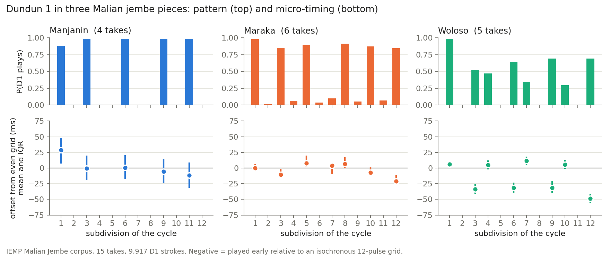
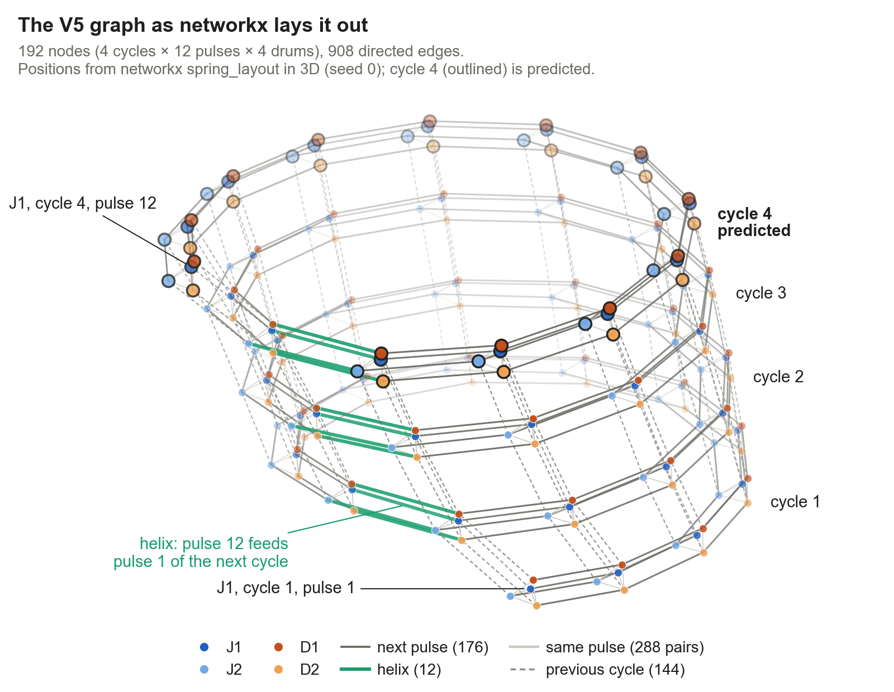

# Djembe: a generative model of Malian jembe micro-timing

I model how Malian jembe ensembles play: which strokes, exactly when, how hard, and in response to the other drummers. The data is the IEMP Malian Jembe corpus (Polak, Tarsitani & Clayton, 2018): 15 multitrack takes of three pieces (Manjanin, Maraka, Woloso), about 51 minutes and 41,072 annotated strokes.

The question: with this little data, does building the symmetries of the 12-pulse cycle into a graph neural network work better than pretraining on a large drum corpus?

Status (October 2026): the dataset and recognition results are done; the generative model is in progress. On its first task, predicting how late or early each stroke falls, the graph model beats the best reference model on 13 of 15 held-out takes, and all three seeds agree on those 13 ([details below](#three-fixes-then-three-seeds-on-savio)). Building the rotation symmetry of the cycle into the network never helps: with 2 training takes it ties, from 4 takes on it loses ([data-efficiency curve](#does-symmetry-help-with-less-data)). The earlier analysis stage (notebooks, listening demo) is at tag [`v0.2-analysis`](https://github.com/clementdumeril/Djembe/tree/v0.2-analysis).



## Recognition

| Task (leave-one-take-out) | Balanced accuracy |
|---|---|
| Piece from the whole-take dundun pattern | 15/15 takes |
| Piece from jembe timing only, pattern masked, 4 cycles | 0.86 (95 % CI 0.74 to 0.95) |
| Same, tempo regressed out of every feature | 0.78 (95 % CI 0.64 to 0.90) |

The dundun result is a ceiling: a nearest-centroid rule already separates the three patterns. The intervals rest on 4 to 6 takes per piece, so they are probably too narrow.

## Humanizing a cycle

The graph model sees 4 cycles: 3 fully known, and a last one where it only knows which drums strike where. It predicts each stroke's offset and intensity as Gaussians, scored by negative log-likelihood on held-out takes (nats, lower is better). References: B1, a Gaussian per piece, drum and pulse; B2, which adds Markov memory of earlier cycles.



*192 nodes (4 cycles × 12 pulses × 4 drums), with next pulse, same pulse, previous cycle and helix edges; networkx computes the positions (3D spring layout), none are placed by hand ([script](experiments/gnn/plot_gnn_graph_nx.py), [schematic](docs/figures/gnn_graph.png)). I trained it with no symmetry (V0), beat symmetry C4 (V1) and full C12 equivariance (V3, no pulse index); the symmetric versions never won, at any data size ([curve below](#does-symmetry-help-with-less-data)).*

Over three seeds on Colab, the first network only ties B2 (−0.709 both, better on 8 of 15 takes, p = 0.60). So my one-seed claim that it beat B2 on 12 of 15 takes does not hold. Symmetry did not help at this data size, even though the jembe feel is close to beat-symmetric in the data (the four beats differ by 1 to 2 ms, against a feel of 3 to 20 ms).

### Three fixes, then three seeds on Savio

1. Keep the last epoch instead of the best epoch on one validation take, which caused most of the seed spread (`--select last`).
2. Helix edge (V5): pulse 12 now feeds pulse 1 of the next cycle, not of the same cycle.
3. Correction to B1 (V4 = V5 + this): the network predicts a correction to B1's Gaussian.

On seed 0 the correction to B1 hurt (V4, −0.652, worse than V5 on 14 of 15 takes), so I dropped it and ran V0 and V5 with three seeds each on UC Berkeley's Savio cluster (45 jobs, about 5 minutes each).

| Offsets | 3 seeds, Savio | Seed 0, laptop | vs B2, per take (3 seeds) |
|---|---|---|---|
| B1 position | −0.579 | −0.579 | |
| B2 Markov, earlier cycles | −0.709 | −0.709 | |
| GNN V0, last epoch | −0.780 | −0.784 | better on 13 of 15 |
| GNN V5, last epoch + helix | **−0.796** | −0.801 | better on 13 of 15 (Wilcoxon p = 0.005, sign test p = 0.007) |


V5 beats B2 by 0.10 nats per stroke on average, so it gives the real offsets about 10 % more probability. The lead does not depend on the seed this time: each seed alone beats B2 on 13 or 14 takes, and V5's overall score moves by 0.013 between seeds. The helix helps a little but steadily: V5 beats V0 on 14 of 15 takes (−0.020, p = 0.007).

The two exceptions: Woloso_1 is a tie (−1.085 against −1.086), and on Manjanin_4 the network loses on all three seeds (−0.42 against −0.59). It is the only Manjanin take whose jembe 1 player plays no other Manjanin take, so the network may have learned the regular players rather than the piece; I have not tested that yet, the scores are not split by drum. On intensity V5 wins on all 15 takes (0.88 against 1.29), but a gap that size may be microphone bleed. Next: the bleed control and per-drum scores.

### Does symmetry help with less data?

Symmetry shares one rule across the beats (V1) or across all 12 pulses (V3), so each rule sees 4 or 12 times more examples. If that pays off anywhere, it should be when data is scarce. So I trained every variant on 2, 4, 8 and 13 takes, with B1 and B2 fitted on the same takes: 180 Savio jobs, nested subsets that always include a take of the test piece, 3 repetitions (subset and seed).

| Training takes | B2 | V0, no symmetry | V1, beat symmetry | V3, pulse rotation | V5, helix |
|---|---|---|---|---|---|
| 2 | −0.310 | −0.558 | −0.547 | −0.560 | −0.558 |
| 4 | −0.631 | **−0.652** | −0.632 | −0.627 | −0.633 |
| 8 | −0.676 | **−0.733** | −0.628 | −0.685 | −0.729 |
| 13 | −0.691 | −0.780 | −0.739 | −0.748 | **−0.795** |


With 2 takes the four networks tie (V1 and V3 against V0: p = 0.89 per take). From 4 takes on, both symmetric versions lose to V0, more clearly as data grows: V1 beats V0 on 4, 1 and 1 of 15 takes at 4, 8 and 13 takes, V3 on 3, 0 and 3 (p from 0.035 down to below 0.001). So the symmetry never pays off here. It costs nothing when data is scarce and costs more as data grows. My reading, not tested: the feel itself is nearly beat-symmetric, but the absolute pulse also tells the network where it is in the dundun figure and the cycle, and that information is worth more than the shared statistics.

The network beats B2 at every size (11, 12, 14 and 14 of 15 takes). Part of its large lead with 2 takes comes from pooling across pieces: B2 is fitted piece by piece, so it learns each piece from one take, while the network uses both. The bump of V1 at 8 takes is one diverged run (Manjanin_4, repetition 2, +1.25); without it V1 still loses on 14 of 15 takes. The helix (V5) ties V0 up to 8 takes and helps at 13 (12 of 15, p = 0.012). At 13 takes B1 and B2 are fitted on the network's 13 takes rather than 14, hence B2 at −0.691 here against −0.709 above.

## Limitations

- 15 takes, 3 pieces, one dundun player, same sessions. Results hold within this corpus only.
- The curve has 3 repetitions per size, and subsets of 2 or 4 takes give some pieces one take or none, so its left end is noisier than its right end.
- Runs are not bit-exact: seed 0 on Savio and on the laptop differ by 0.02 per take on average (up to 0.12), and rerunning J3 on Colab gave V0 −0.736 instead of −0.709. Three seeds are enough to see that the V5 lead is larger than this noise, not to measure it precisely.

Corpus erratum: one published OSF file holds the wrong take; I use the correct ones ([details](docs/CORPUS_ERRATUM.md)).

## Install and run

```bash
pip install -e ".[dev]"
python -m djembe.dataset download     # annotations only, about 10 MB from OSF
python -m djembe.dataset build        # output/events.csv, about 7 s
python -m pytest -q                   # a few seconds
python experiments/gnn/train_humanize.py --variants V0 V4 V5 --seeds 0 --select last --out results/j3b_humanize_seed0_cpu.json   # about 2 h in 4 parallel parts (--takes)
```

Folds are frozen by take in [`splits.json`](splits.json); the tests fail if a take is on both sides. Full tables and commands: [`docs/RESULTS.md`](docs/RESULTS.md).

[`colab/j3_humanize.ipynb`](colab/j3_humanize.ipynb) runs the three-seed version. On UC Berkeley's Savio cluster, [`savio/`](savio/README.md) runs every take and seed as one SLURM job array and merges the parts. If OSF refuses the download (403), run `python -m djembe.dataset pack` and put `output/djembe_corpus.zip` at the root of your Google Drive; the notebook then skips OSF. Keep that file private.

## License and credits

Code: [MIT License](LICENSE). The IEMP Malian Jembe corpus is licensed CC BY-NC-ND 4.0 by its authors and is not redistributed here; `djembe/dataset.py` downloads it from OSF (https://osf.io/m652x/). The event table, audio and trained weights stay out of the repository.

- Corpus: Polak, R., Tarsitani, S., & Clayton, M. (2018). *IEMP Malian Jembe* [Data set]. OSF. https://doi.org/10.17605/OSF.IO/M652X. The recordings and annotations are theirs.
- Polak, R. (2004). *Festmusik als Arbeit, Trommeln als Beruf*. Dietrich Reimer. https://d-nb.info/971098840
- Clayton, M., et al. (2021). The Interpersonal Entrainment in Music Performance Data Collection. *Empirical Musicology Review, 16*(1), 65–84. https://doi.org/10.18061/emr.v16i1.7555
- Polak, R. (2010). Rhythmic feel as meter. *Music Theory Online, 16*(4). https://doi.org/10.30535/mto.16.4.4
- Polak, R., & London, J. (2014). Timing and meter in Mande drumming from Mali. *Music Theory Online, 20*(1). https://doi.org/10.30535/mto.20.1.1
- Polak, R., London, J., & Jacoby, N. (2016). Both isochronous and non-isochronous metrical subdivision afford precise and stable ensemble entrainment: A corpus study of Malian jembe drumming. *Frontiers in Neuroscience, 10*, 285. https://doi.org/10.3389/fnins.2016.00285
