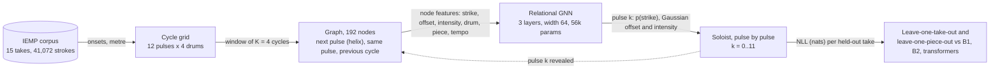

# Djembe: a generative model of Malian jembe micro-timing

A relational graph network over the 12-pulse cycle predicts and generates the soloist of Malian jembe ensembles stroke by stroke (strike, timing, intensity) on the IEMP corpus, and on a rhythm left out of training it beats a same-size Music-Transformer-style model and two statistical references on all 15 held-out takes.

[Results and commands](docs/RESULTS.md) · [Findings in detail](docs/FINDINGS.md) · [Corpus (OSF)](https://doi.org/10.17605/OSF.IO/M652X) · [Corpus erratum](docs/CORPUS_ERRATUM.md)

[](https://github.com/clementdumeril/Djembe/actions/workflows/tests.yml)


*Negative log-likelihood of the held-out soloist (lower is better), one dot per take, 15 takes x 3 seeds. Left group of each panel: rhythm seen in training; right group: rhythm never heard.*

## Overview

The data is the IEMP Malian Jembe corpus (Polak, Tarsitani & Clayton, 2018): 15 multitrack takes of three pieces (Manjanin, Maraka, Woloso), about 51 minutes and 41,072 annotated strokes, one dundun player throughout. The question is whether, with this little data, building the structure of the cycle into a small graph network works, and which symmetries help. Models are always tested on whole takes they never saw (or on a whole piece); the take-level folds are frozen in [`splits.json`](splits.json) and the tests fail if a take is on both sides.

What is mine: the event table and splits, the reference models, the graph network and its variants, the Music-Transformer-style comparison model (my own implementation of relative attention), the stroke-type labelling, the generation and evaluation code, and the live-play prototype. Reused: the corpus, its onsets and metre annotations (Polak, Tarsitani & Clayton), the musicological results on non-isochronous subdivision that the analysis replicates (Polak 2010; Polak & London 2014; Polak, London & Jacoby 2016), and CC0 drum samples for rendering.



*Soloist model ([`solo_seq.py`](djembe/solo_seq.py), network in [`gnn.py`](djembe/gnn.py)): the accompaniment of the target cycle is known, the soloist's pulses are predicted in order. References ([`baselines.py`](djembe/baselines.py)): B1, a Gaussian per piece, drum and pulse; B2, which adds Markov memory of earlier cycles.*

## Results

All scores are negative log-likelihoods on held-out takes (nats per stroke or per pulse, lower is better), mean of 3 seeds, compared take by take with a two-sided Wilcoxon test.

Soloist, stroke by stroke ([`j6_take_savio.json`](results/j6_take_savio.json), [`j6_piece_savio.json`](results/j6_piece_savio.json)):

| Model (parameters) | Seen rhythm: strikes / offsets / intensities | Unseen rhythm: strikes / offsets / intensities |
| :-- | --: | --: |
| Graph network (56k) | 0.407 / -0.945 / 1.220 | 0.436 / -0.565 / 1.233 |
| Transformer, same size (60k) | 0.423 / -0.844 / 1.243 | 0.548 / 0.411 / 1.340 |
| Transformer (181k) | 0.436 / -0.704 / 1.355 | 0.590 / 1.055 / 1.538 |
| B2, Markov | 0.537 / -0.749 / 1.393 | 0.631 / 0.045 / 1.429 |
| B1, per position | 0.597 / -0.573 / 1.396 | 0.645 / -0.281 / 1.432 |

Seen rhythm (leave-one-take-out, piece given): the graph network beats the same-size transformer on 12 of 15 takes for strikes (p = 0.015) and 14 of 15 for offsets (p = 0.0003); intensities tie (10 of 15, p = 0.15). Removing the piece label costs it nothing (0.407 / -0.954 / 1.215, [`j6_take_nopiece_savio.json`](results/j6_take_nopiece_savio.json)). Unseen rhythm (trained on two pieces, tested on every take of the third): it beats every other model on all 15 takes for all three quantities (p = 0.0001), while the transformers fall below the per-position average on offsets. The 181k transformer overfits the 15 takes.

Humanizing a cycle, the first task: offsets of every stroke in the last of 4 cycles, strikes known ([`j3b_humanize_3seeds_savio.json`](results/j3b_humanize_3seeds_savio.json)):

| Model | Offsets (nats) | Better than B2 on |
| :-- | --: | --: |
| B1, per position | -0.579 | |
| B2, Markov over earlier cycles | -0.709 | |
| Graph network, no symmetry (V0) | -0.780 | 13 of 15 takes |
| Graph network, helix edge (V5) | -0.796 | 13 of 15 takes (p = 0.005) |


Building symmetry into the network did not help at any data size ([`j4_curve_savio.json`](results/j4_curve_savio.json), [figure](docs/figures/j4_curve.png)). Trained on 2, 4, 8 and 13 takes (3 repetitions each), beat symmetry (C4) and rotation of the whole cycle (C12) tie the unconstrained network with 2 takes and lose from 4 takes on: C4 beats it on 4, 1 and 1 of 15 takes at 4, 8 and 13 training takes. The network beats B2 at every size.

In free generation (temperature 1), successive timing deviations correlate at 0.44 (real soloists 0.56, Markov 0.54), and the solos vary more than real ones (69 % distinct figures per cycle, real 36 %).

Recognising the piece is trivial from the dundun pattern (15/15 takes) and still works from jembe timing alone, pattern masked (balanced accuracy 0.86 over 4 cycles, 95 % CI 0.74 to 0.95, [`a2_recognition.json`](results/a2_recognition.json)).

## Status

- [x] Event table, frozen take-level splits, recognition baselines, reference models
- [x] Graph network for timing (J3b), symmetry study (J4), soloist generation (J5b), graph network against transformer (J6)
- [x] Live step L1: a Kalman grid tracker on a streamed jembe-2 track predicts the next stroke 100 ms ahead within 8.0 ms median on the 9 of 12 takes it tracks, against 18.2 ms for an isochronous grid ([`live_tracking.json`](results/live_tracking.json))
- [x] Live step L2: a causal soloist that hears only jembe 2, up to the previous pulse, beats B2 on 12 of 12 takes and stays close to the offline model (0.435 / -0.955 / 1.238 against 0.429 / -0.969 / 1.223, [`live_take_savio.json`](results/live_take_savio.json))
- [x] J7: a memory of the soloist's own figures does not improve prediction (the base model is better on 12 of 15 takes for strikes and offsets, [`j7_savio.json`](results/j7_savio.json))
- [ ] J8: two-stage soloist (figure planner, then the graph network), job written, no results yet
- [ ] Real-time engine, calibration on a live player, blind listening test

## Installation

Tested with Python 3.11 (CI on Ubuntu); training ran on a laptop CPU, on Colab and on UC Berkeley's Savio cluster.

```bash
git clone https://github.com/clementdumeril/Djembe.git && cd Djembe
pip install -e ".[dev,train,audio]"    # train: torch, torch-geometric, wandb; audio: soundfile
pip install -r requirements-train.txt  # optional: the pinned versions used locally
```

## Usage

```bash
python -m pytest -q                    # without the corpus: 109 passed, 4 skipped, under a minute
python -m djembe.dataset download      # annotations only, about 10 MB from OSF
python -m djembe.dataset build         # output/events.csv, about 7 s
python experiments/j6/run.py --protocol take --index 0 --epochs 2   # quick check of the J6 pipeline on one take
python experiments/gnn/train_humanize.py --variants V0 V4 V5 --seeds 0 --select last --out results/j3b_humanize_seed0_cpu.json   # about 2 h on a laptop CPU
```

The full runs are SLURM job arrays, one task per take and seed ([`savio/README.md`](savio/README.md)); every command and output file is listed in [`docs/RESULTS.md`](docs/RESULTS.md#commands). [`colab/j3_humanize.ipynb`](colab/j3_humanize.ipynb) runs the three-seed timing study.

## Reproducing figures

```bash
python experiments/j6/plot.py --out docs/figures/j6_gnn_transformer.png
python experiments/gnn/plot_humanize.py results/j3b_humanize_3seeds_savio.json docs/figures/j3b_humanize_3seeds_savio.png
python experiments/gnn/plot_curve.py results/j4_curve_savio.json docs/figures/j4_curve.png
python experiments/recognition/make_figures.py   # hero and step-0 figures (needs the corpus)
```

## Code structure

| Component | File | Role |
| :-- | :-- | :-- |
| Data | [`djembe/dataset.py`](djembe/dataset.py), [`grid.py`](djembe/grid.py) | OSF download, event table, cycle grid and graph edges |
| References | [`djembe/baselines.py`](djembe/baselines.py) | B1 per position, B2 Markov |
| Graph network | [`djembe/gnn.py`](djembe/gnn.py), [`solo.py`](djembe/solo.py), [`solo_seq.py`](djembe/solo_seq.py) | Relational message passing; soloist strike and stroke-by-stroke models |
| Transformer | [`djembe/transformer.py`](djembe/transformer.py) | Encoder over the accompaniment, causal decoder with relative-position bias |
| Strokes | [`djembe/strokes.py`](djembe/strokes.py), [`stroke_types.py`](djembe/stroke_types.py) | Bass / tone / slap from the audio and from the grid |
| Generation and live | [`djembe/generate.py`](djembe/generate.py), [`live.py`](djembe/live.py), [`render.py`](djembe/render.py) | Sampling, grid tracker, audio rendering with CC0 samples |
| Experiments | [`experiments/`](experiments/) | One folder per study (recognition, gnn, generation, j6, j7, live, strokes) |
| Results | [`results/`](results/) | One JSON per run or merged campaign |
| Tests | [`tests/`](tests/) | Splits without leakage, model symmetries, no corpus-derived file committed |

## Limitations

- 15 takes, 3 pieces, one dundun player, same sessions: results hold within this corpus only.
- Leave-one-piece-out has 3 training configurations; no model had a hyperparameter search.
- On Manjanin_4 the timing network loses to B2 on all three seeds; it is the only Manjanin take whose soloist plays no other Manjanin take. Not tested further.
- Stroke types (bass, tone, slap) are read from the audio; they agree with a player's ear at 75 % on 105 strokes.
- Runs are not bit-exact: seed 0 on Savio and on a laptop differ by 0.02 nats per take on average (up to 0.12).
- Generated audio and renders over the corpus' microphones are not published (corpus licence).

## Citation, license and credits

Code: MIT, see [`LICENSE`](LICENSE) and [`CITATION.cff`](CITATION.cff). The corpus is CC BY-NC-ND 4.0 by its authors and is not redistributed; `djembe/dataset.py` downloads it from OSF. The event table, audio and trained weights stay out of the repository. Drum samples: CC0, see [`assets/samples/CREDITS.md`](assets/samples/CREDITS.md).

- Polak, R., Tarsitani, S., & Clayton, M. (2018). *IEMP Malian Jembe* [Data set]. OSF. https://doi.org/10.17605/OSF.IO/M652X
- Clayton, M., et al. (2021). The Interpersonal Entrainment in Music Performance Data Collection. *Empirical Musicology Review, 16*(1), 65-84. https://doi.org/10.18061/emr.v16i1.7555
- Polak, R. (2004). *Festmusik als Arbeit, Trommeln als Beruf*. Dietrich Reimer. https://d-nb.info/971098840
- Polak, R. (2010). Rhythmic feel as meter. *Music Theory Online, 16*(4). https://doi.org/10.30535/mto.16.4.4
- Polak, R., & London, J. (2014). Timing and meter in Mande drumming from Mali. *Music Theory Online, 20*(1). https://doi.org/10.30535/mto.20.1.1
- Polak, R., London, J., & Jacoby, N. (2016). Both isochronous and non-isochronous metrical subdivision afford precise and stable ensemble entrainment. *Frontiers in Neuroscience, 10*, 285. https://doi.org/10.3389/fnins.2016.00285
- Huang, C.-Z. A., et al. (2018). Music Transformer. [arXiv:1809.04281](https://arxiv.org/abs/1809.04281). Relative attention, reimplemented here in the additive form of Raffel et al. (2020), [arXiv:1910.10683](https://arxiv.org/abs/1910.10683).

The earlier analysis stage (notebooks, listening demo) is at tag [`v0.2-analysis`](https://github.com/clementdumeril/Djembe/tree/v0.2-analysis). Clément Dumeril · [clement.dumeril.net](https://clement.dumeril.net)
