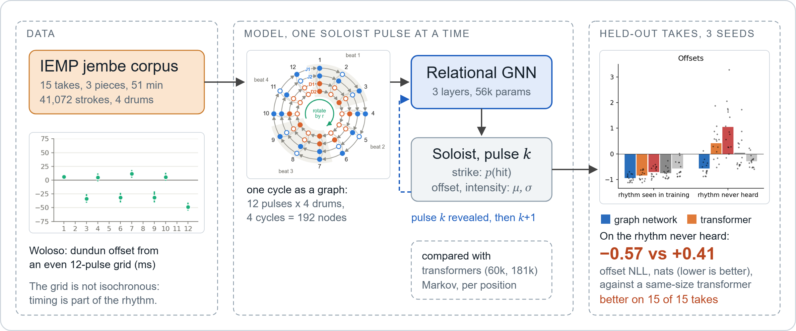
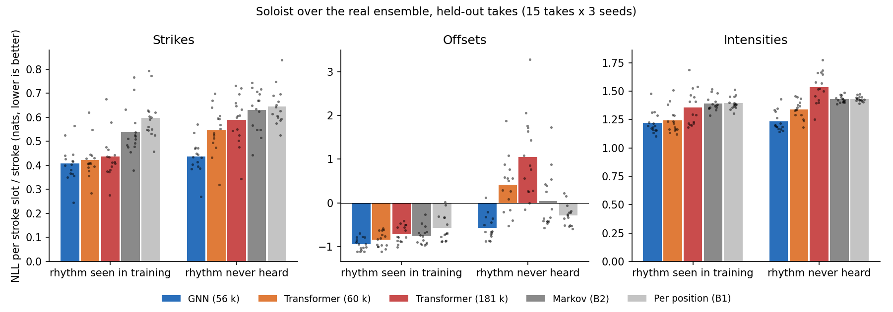

# Djembe: a generative model of Malian jembe micro-timing

[Results and commands](docs/RESULTS.md) · [Findings in detail](docs/FINDINGS.md) · [Corpus (OSF)](https://doi.org/10.17605/OSF.IO/M652X) · [Corpus erratum](docs/CORPUS_ERRATUM.md)

[](https://github.com/clementdumeril/Djembe/actions/workflows/tests.yml)



A small relational graph network over the 12-pulse cycle predicts and generates the soloist of Malian jembe ensembles stroke by stroke (strike, timing offset, intensity), trained on the 15 takes of the IEMP corpus. On a rhythm left out of training it beats a same-size Music-Transformer-style model on all 15 held-out takes for strikes, offsets and intensities (offset NLL -0.565 against 0.411 nats, p = 0.0001).

## Method

Each take becomes a grid of 12 pulses x 4 drums per cycle; a window of 4 cycles is a 192-node graph with three edge types (next pulse, same pulse, previous cycle). The accompaniment of the target cycle is known and the soloist's pulses are predicted in order: a Bernoulli strike, then Gaussian offset and intensity. Models are always scored on whole takes they never saw, or on a whole piece; the take-level folds are frozen in [`splits.json`](splits.json) and the tests fail if a take is on both sides.

Mine: event table and splits, reference models, the graph network and its variants, the transformer comparison (my implementation of relative attention), stroke-type labelling, generation, evaluation and the live prototype. Reused: the corpus and its annotations (Polak, Tarsitani & Clayton) and CC0 drum samples.

## Results

Negative log-likelihood on held-out takes (nats, lower is better), mean of 3 seeds ([`j6_take.json`](results/j6_take.json), [`j6_piece.json`](results/j6_piece.json)):

| Model (parameters) | Seen rhythm: strikes / offsets / intensities | Unseen rhythm: strikes / offsets / intensities |
| :-- | --: | --: |
| Graph network (56k) | **0.407 / -0.945 / 1.220** | **0.436 / -0.565 / 1.233** |
| Transformer, same size (60k) | 0.423 / -0.844 / 1.243 | 0.548 / 0.411 / 1.340 |
| Transformer (181k) | 0.436 / -0.704 / 1.355 | 0.590 / 1.055 / 1.538 |
| B2, Markov | 0.537 / -0.749 / 1.393 | 0.631 / 0.045 / 1.429 |
| B1, per position | 0.597 / -0.573 / 1.396 | 0.645 / -0.281 / 1.432 |



*One dot per held-out take, 15 takes x 3 seeds. On the seen rhythm the graph network beats the same-size transformer on 12 of 15 takes for strikes and 14 of 15 for offsets; intensities tie.*

Other findings, with their files in [`docs/RESULTS.md`](docs/RESULTS.md):

- Humanizing a cycle (offsets of the last of 4 cycles, strikes known): the graph network with a helix edge reaches -0.796 nats against -0.709 for the Markov reference, better on 13 of 15 takes.
- Building beat or cycle symmetry into the network did not help at any training size (2 to 13 takes).
- The piece is recognised from jembe timing alone, pattern masked: balanced accuracy 0.86 over 4 cycles.
- Live prototype: a Kalman grid tracker predicts the next stroke 100 ms ahead within 8.0 ms median, against 18.2 ms for an isochronous grid.

## Install and quick start

Python 3.11 (CI on Ubuntu). Training ran on a laptop CPU, on Colab and on a Slurm cluster.

```bash
git clone https://github.com/clementdumeril/Djembe.git && cd Djembe
pip install -e ".[dev,train,audio]"    # train: torch, torch-geometric, wandb; audio: soundfile
python -m pytest -q                    # without the corpus: 109 passed, 4 skipped
python -m djembe.dataset download      # annotations only, about 10 MB from OSF
python -m djembe.dataset build         # output/events.csv, about 7 s
python experiments/j6/run.py --protocol take --index 0 --epochs 2   # quick check of the J6 pipeline on one take
```

Full runs are Slurm job arrays, one task per take and seed ([`slurm/README.md`](slurm/README.md)). Every command and output file is in [`docs/RESULTS.md`](docs/RESULTS.md#commands); [`colab/j3_humanize.ipynb`](colab/j3_humanize.ipynb) runs the three-seed timing study.

## Code structure

| Path | Role |
| :-- | :-- |
| [`djembe/dataset.py`](djembe/dataset.py), [`grid.py`](djembe/grid.py) | OSF download, event table, cycle grid and graph edges |
| [`djembe/gnn.py`](djembe/gnn.py), [`solo_seq.py`](djembe/solo_seq.py) | Relational message passing, stroke-by-stroke soloist |
| [`djembe/transformer.py`](djembe/transformer.py), [`baselines.py`](djembe/baselines.py) | Comparison models: relative-attention transformer, B1, B2 |
| [`djembe/generate.py`](djembe/generate.py), [`live.py`](djembe/live.py), [`render.py`](djembe/render.py) | Sampling, grid tracker, audio rendering |
| [`experiments/`](experiments/), [`slurm/`](slurm/), [`results/`](results/) | One folder per study, job arrays, one JSON per run |
| [`tests/`](tests/) | Splits without leakage, model symmetries, no corpus file committed |

## Limitations

- 15 takes, 3 pieces, one dundun player, same sessions: results hold within this corpus only.
- Leave-one-piece-out has 3 training configurations; no model had a hyperparameter search.
- Stroke types (bass, tone, slap) are read from the audio and agree with a player's ear at 75 % on 105 strokes.
- Runs are not bit-exact: seed 0 on the cluster and on a laptop differ by 0.02 nats per take on average (up to 0.12).
- Generated audio and renders over the corpus' microphones are not published (corpus licence).

## Citation, license and credits

Code: MIT ([`LICENSE`](LICENSE), [`CITATION.cff`](CITATION.cff)). The corpus is CC BY-NC-ND 4.0 and is not redistributed; `djembe/dataset.py` downloads it from OSF. Drum samples: CC0, see [`assets/samples/CREDITS.md`](assets/samples/CREDITS.md).

- Polak, R., Tarsitani, S., & Clayton, M. (2018). *IEMP Malian Jembe* [Data set]. OSF. https://doi.org/10.17605/OSF.IO/M652X
- Clayton, M., et al. (2021). The Interpersonal Entrainment in Music Performance Data Collection. *Empirical Musicology Review, 16*(1), 65-84. https://doi.org/10.18061/emr.v16i1.7555
- Polak, R. (2004). *Festmusik als Arbeit, Trommeln als Beruf*. Dietrich Reimer. https://d-nb.info/971098840
- Polak, R. (2010). Rhythmic feel as meter. *Music Theory Online, 16*(4). https://doi.org/10.30535/mto.16.4.4
- Polak, R., & London, J. (2014). Timing and meter in Mande drumming from Mali. *Music Theory Online, 20*(1). https://doi.org/10.30535/mto.20.1.1
- Polak, R., London, J., & Jacoby, N. (2016). Both isochronous and non-isochronous metrical subdivision afford precise and stable ensemble entrainment. *Frontiers in Neuroscience, 10*, 285. https://doi.org/10.3389/fnins.2016.00285
- Huang, C.-Z. A., et al. (2018). Music Transformer. [arXiv:1809.04281](https://arxiv.org/abs/1809.04281), relative attention in the additive form of Raffel et al. (2020), [arXiv:1910.10683](https://arxiv.org/abs/1910.10683).

The earlier analysis stage (notebooks, listening demo) is at tag [`v0.2-analysis`](https://github.com/clementdumeril/Djembe/tree/v0.2-analysis). Clément Dumeril · [clement.dumeril.net](https://clement.dumeril.net)
