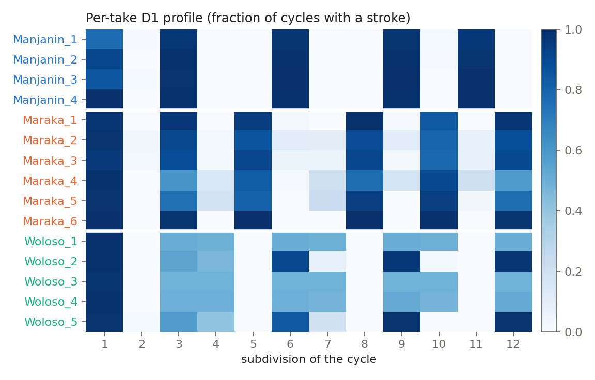

# Djembe: micro-timing analysis and learning experiments on Malian jembe drumming

Analysis of 15 multitrack recordings of Malian jembe ensembles (about 51 minutes, 41,072 annotated strokes). The project is building towards models that recognise and regenerate these rhythms with their micro-timing.


I started this in June 2026 as a personal project. The data is the IEMP Malian Jembe corpus (Polak, Tarsitani & Clayton, 2018), and it builds on Rainer Polak's doctoral research on jembe drumming in Bamako (Polak, 2004). The question: how much of a rhythm's identity lives in its pattern, and how much in the timing of each stroke? Can a model learn both from such a small corpus? At this stage the analysis pipeline and an audited dataset are done. No neural network has been trained yet: that is the next step.

## Results

| What | Result | Source |
|---|---|---|
| Rhythm from the per-take dundun pattern, leave-one-take-out | 15/15 takes (random forest and nearest centroid; 95 % CI 0.78 to 1.00); majority class 6/15 | [`results/step0_rf.json`](results/step0_rf.json) |
| Same classifier on the previously used annotation files | 12/14: both errors trace back to one mislabelled file in the public corpus (see How I checked it) | [`step0_rf_baseline.py`](step0_rf_baseline.py) |
| Dundun timing against an even 12-pulse grid | Woloso strokes on pulses 3, 6, 9, 12 land 30 to 50 ms early, Maraka within about ±20 ms (figure above) | [`make_figures.py`](make_figures.py) |
| Event table | 41,072 strokes, 15 takes, 4 instruments, 1,955 annotated cycles | [`djembe_dataset.py`](djembe_dataset.py) |



The perfect score says the task is too easy, not that the model is good. The three dundun patterns are so distinct that a nearest-centroid rule separates them. The recognition work therefore moves to harder versions: a few cycles instead of a whole take, and timing alone with the pattern masked.

## What I built

- [`djembe_dataset.py`](djembe_dataset.py): downloads the annotations from OSF and builds one event table. Each row is one stroke: take, instrument, player, cycle, subdivision, onset, peak amplitude, offset from the even grid (fraction of a pulse and ms), musical section. Every later experiment reads only this table.
- [`splits.json`](splits.json) and [`tests/test_splits.py`](tests/test_splits.py): frozen leave-one-take-out folds, plus 20 tests. They fail if a take ends up on both sides of a split, or if the event table disagrees with its file labels.
- [`step0_rf_baseline.py`](step0_rf_baseline.py): the first reproducible number, computed from the table and the frozen folds against two reference models.
- [`colab/00_step0_dataset_baseline.ipynb`](colab/00_step0_dataset_baseline.ipynb): the same pipeline on Google Colab. Pinned dependencies, GPU detection with CPU fallback, the corpus downloaded into the session and outputs written to Google Drive. Later training notebooks follow this template.
- Analysis notebooks `01` to `07` (dundun extraction, tempo and accelerando, micro-timing, Fourier fingerprint of the 12-pulse pattern).
- [`boussole_rythmes_V2.py`](boussole_rythmes_V2.py): a self-contained interactive page. It draws each rhythm on a 12-pulse circle with its complex Fourier coefficients and plays the recordings or a resynthesis.
- Earlier experiments are kept in `archive/`: informed NMF source separation, recognising a YouTube recording from separated dundun onsets, and a second-order Markov generator with measured swing. None of them has a proper evaluation yet.

## How it works

The corpus annotates every metric position of every cycle: 12 pulses per row of the metre file. Each stroke is placed relative to its cycle:

```
phase = (onset - cycle_start) / cycle_duration
offset = phase - (pulse - 1) / 12          (fraction of a cycle; x12 for pulses, x duration for ms)
```

An offset of zero means an isochronous grid. Polak's work showed that this music is not isochronous: in some pieces the pulses come in short-medium-long groups. The event table keeps these offsets as continuous values, so that the same table can feed a classifier (pattern and timing features) and a sequence model (strokes plus a continuous timing output).

Woloso's metre file labels half-cycles (`1.1`, `1.2`), and the two halves carry different dundun figures. Its averaged pattern in the figures therefore shows probabilities around 0.5.

## How I checked it

- **Data audit.** The OSF file `MJ_Maraka_5_Onsets_Selected.csv` actually contains take Woloso_5. Its dundun onsets match the raw Woloso_5 onsets at 99 % and the raw Maraka_5 onsets at 10 %. Woloso_5 has no file of its own. Earlier versions of my analysis used these files, so one Woloso take was labelled Maraka and Woloso was short of a take. Replaying the old classifier reproduces 12/14: the mislabelled take is "misclassified" as Woloso (which is correct), and Woloso_2 falls to Maraka. The event table reads the `_Onsets_Selected_Peak` files instead: for all 15 takes, their dundun onsets match the raw onsets at 99.9 % or more. A test now asserts that file labels and table labels agree. Details in [`docs/CORPUS_ERRATUM.md`](docs/CORPUS_ERRATUM.md).
- **Leakage.** The split unit is the take, never the stroke or the cycle. The same dundun player (Madu Jakite) plays on every take, so a split by musician is impossible. An abandoned experiment in `archive/v2_abandonne` used stratified folds over strokes, which mixes strokes of one take between train and test. `iter_folds` now refuses any split that shares a take.
- **Reference points.** Every score is reported next to the majority class and a nearest-centroid rule, with an exact binomial interval. Over 15 takes, a bootstrap collapses to [1, 1] at perfect accuracy; the exact interval does not.

## Limitations

- 15 takes, 3 pieces, one dundun player, four jembe players in total, all recorded in the same sessions. Any result holds within this corpus. It says nothing about other musicians or other rhythms.
- Recognising the piece from a whole take is solved by a trivial rule, so it is not a meaningful benchmark on its own.
- No neural model has been trained yet. The generation results in `archive/` were judged only by ear.
- The corpus licence (CC BY-NC-ND 4.0) forbids redistributing derived data. The event table, extracted audio and any trained weights stay out of the repository. Only code, fold definitions, aggregate metrics and figures are versioned.

## Next

1. Recognition from 1, 2 or 4 cycles and from timing alone: a feature baseline against a small 1D CNN or transformer on stroke sequences.
2. Generation: a sequence model over strokes, conditioned on the rhythm, with a continuous timing head. Evaluated with distances between timing distributions per pulse, a check that the model does not copy its training data, and a blind listening test.

## Reproduce

```bash
pip install -r requirements-train.txt
python djembe_dataset.py download     # annotations only, about 10 MB from OSF
python djembe_dataset.py build        # output/events.csv, about 7 s
python djembe_dataset.py splits       # regenerates splits.json (deterministic)
python -m pytest -q tests             # 20 tests, about 3 s
python step0_rf_baseline.py           # results/step0_rf.json, about 20 s on 2 threads
python make_figures.py                # docs/figures/
```

On Colab, open `colab/00_step0_dataset_baseline.ipynb` and run all cells. The analysis notebooks and the interactive page need the audio (`python djembe_dataset.py download --audio`, about 900 MB) and the packages in `requirements.txt`. Their French documentation is in [`docs/GUIDE_FR.md`](docs/GUIDE_FR.md).

## Credits

- Corpus: Polak, R., Tarsitani, S., & Clayton, M. (2018). *IEMP Malian Jembe* [Data set]. OSF. https://doi.org/10.17605/OSF.IO/M652X. Licence CC BY-NC-ND 4.0. Recordings, annotated onsets, metre and form annotations are theirs.
- Founding thesis: Polak, R. (2004). *Festmusik als Arbeit, Trommeln als Beruf: Jenbe-Spieler in einer westafrikanischen Großstadt*. Berlin: Dietrich Reimer. ISBN 978-3-496-02771-3. Doctoral thesis, Universität Bayreuth, 2002. https://d-nb.info/971098840
- Collection paper: Clayton, M., et al. (2021). The Interpersonal Entrainment in Music Performance Data Collection. *Empirical Musicology Review, 16*(1), 65–84. https://doi.org/10.18061/emr.v16i1.7555
- Micro-timing findings reproduced in the notebooks: Polak, R. (2010). Rhythmic feel as meter. *Music Theory Online, 16*(4), https://doi.org/10.30535/mto.16.4.4. Polak, R., & London, J. (2014). Timing and meter in Mande drumming from Mali. *Music Theory Online, 20*(1), https://doi.org/10.30535/mto.20.1.1. Polak, R., London, J., & Jacoby, N. (2016). *Frontiers in Neuroscience, 10*, 285, https://doi.org/10.3389/fnins.2016.00285
- Tools: librosa, scikit-learn, pandas, matplotlib, UMAP. The interactive page can optionally load reference patterns from djembeloops.com; they are fetched locally by `import_djembeloops_reference.py` and not redistributed.

## License

The code in this repository is under the [MIT License](LICENSE). The IEMP Malian Jembe corpus is not part of it: it is licensed CC BY-NC-ND 4.0 by its authors, is not redistributed here, and is downloaded from OSF (https://osf.io/m652x/) by `djembe_dataset.py`.

Clément Dumeril · https://clement.dumeril.net · https://github.com/clementdumeril
