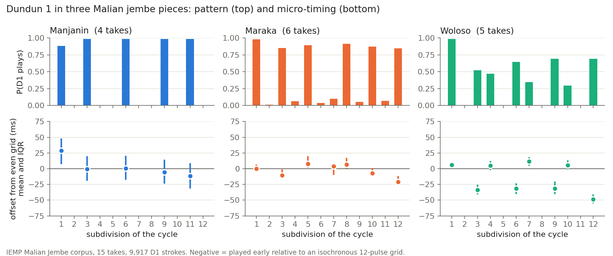
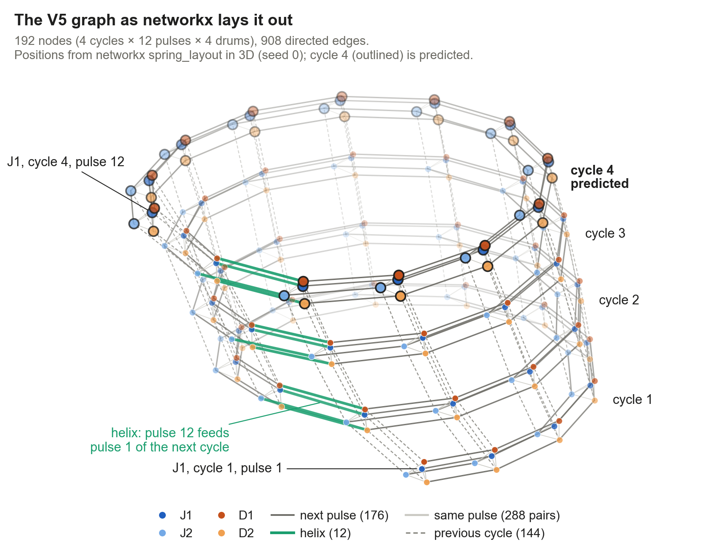
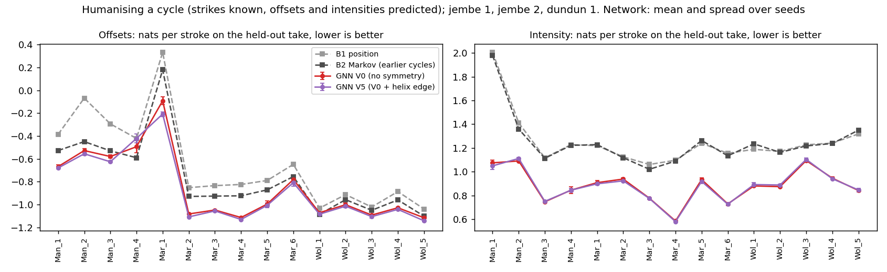
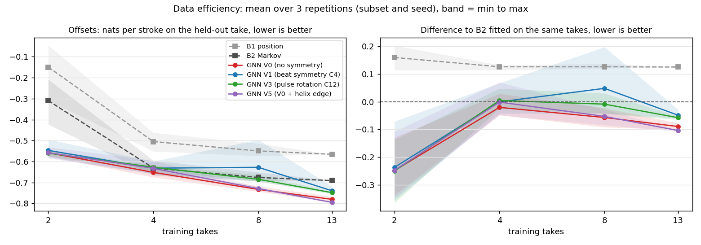
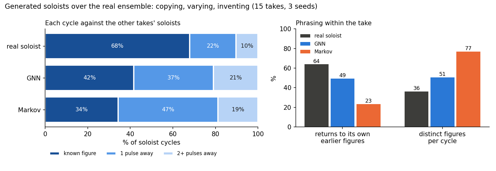
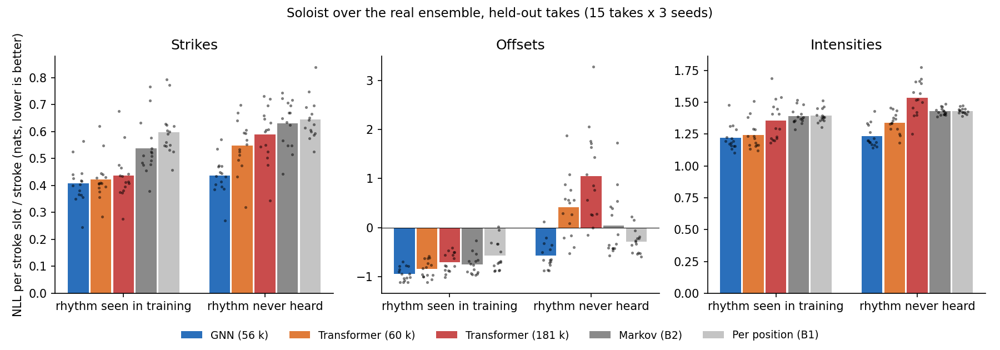

# Findings in detail

The long version of the README results, with the reasoning behind each step and the failed attempts. Tables with every number and the commands that produce them: [`RESULTS.md`](RESULTS.md).

## Recognition

| Task (leave-one-take-out) | Balanced accuracy |
|---|---|
| Piece from the whole-take dundun pattern | 15/15 takes |
| Piece from jembe timing only, pattern masked, 4 cycles | 0.86 (95 % CI 0.74 to 0.95) |
| Same, tempo regressed out of every feature | 0.78 (95 % CI 0.64 to 0.90) |

The dundun result is a ceiling: a nearest-centroid rule already separates the three patterns. The intervals rest on 4 to 6 takes per piece, so they are probably too narrow.

## Humanizing a cycle

The graph model sees 4 cycles: 3 fully known, and a last one where it only knows which drums strike where. It predicts each stroke's offset and intensity as Gaussians, scored by negative log-likelihood on held-out takes (nats, lower is better). References: B1, a Gaussian per piece, drum and pulse; B2, which adds Markov memory of earlier cycles.

*192 nodes (4 cycles × 12 pulses × 4 drums), with next pulse, same pulse, previous cycle and helix edges; networkx computes the positions (3D spring layout), none are placed by hand ([script](../experiments/gnn/plot_gnn_graph_nx.py), [schematic](figures/gnn_graph.png)). I trained it with no symmetry (V0), beat symmetry C4 (V1) and full C12 equivariance (V3, no pulse index); the symmetric versions never won, at any data size ([curve below](#does-symmetry-help-with-less-data)).*

Over three seeds on Colab, the first network only ties B2 (−0.709 both, better on 8 of 15 takes, p = 0.60). So my one-seed claim that it beat B2 on 12 of 15 takes does not hold. Symmetry did not help at this data size, even though the jembe feel is close to beat-symmetric in the data (the four beats differ by 1 to 2 ms, against a feel of 3 to 20 ms).

### Three fixes, then three seeds on Savio

1. Keep the last epoch instead of the best epoch on one validation take, which caused most of the seed spread (`--select last`).
2. Helix edge (V5): pulse 12 now feeds pulse 1 of the next cycle, not of the same cycle.
3. Correction to B1 (V4 = V5 + this): the network predicts a correction to B1's Gaussian.

On seed 0 the correction to B1 hurt (V4, −0.652, worse than V5 on 14 of 15 takes), so I dropped it and ran V0 and V5 with three seeds each on UC Berkeley's Savio cluster (45 jobs, about 5 minutes each).

| Offsets | 3 seeds, Savio | Seed 0, laptop | vs B2, per take (3 seeds) |
|---|---|---|---|
| B1 position | −0.579 | −0.579 | |
| B2 Markov, earlier cycles | −0.709 | −0.709 | |
| GNN V0, last epoch | −0.780 | −0.784 | better on 13 of 15 |
| GNN V5, last epoch + helix | **−0.796** | −0.801 | better on 13 of 15 (Wilcoxon p = 0.005, sign test p = 0.007) |

V5 beats B2 by 0.087 nats per stroke (0.10 averaged over takes), so it gives the real offsets about 9 % more probability. The lead does not depend on the seed this time: each seed alone beats B2 on 13 or 14 takes, and V5's overall score moves by 0.013 between seeds. The helix helps a little but steadily: V5 beats V0 on 14 of 15 takes (−0.020, p = 0.007).

The two exceptions: Woloso_1 is a tie (−1.085 against −1.086), and on Manjanin_4 the network loses on all three seeds (−0.42 against −0.59). It is the only Manjanin take whose jembe 1 player plays no other Manjanin take, so the network may have learned the regular players rather than the piece; I have not tested that yet, the scores are not split by drum. On intensity V5 wins on all 15 takes (0.88 against 1.29), but a gap that size may be microphone bleed. Next: the bleed control and per-drum scores.

### Does symmetry help with less data?

Symmetry shares one rule across the beats (V1) or across all 12 pulses (V3), so each rule sees 4 or 12 times more examples. If that pays off anywhere, it should be when data is scarce. So I trained every variant on 2, 4, 8 and 13 takes, with B1 and B2 fitted on the same takes: 180 Savio jobs, nested subsets that always include a take of the test piece, 3 repetitions (subset and seed).

| Training takes | B2 | V0, no symmetry | V1, beat symmetry | V3, pulse rotation | V5, helix |
|---|---|---|---|---|---|
| 2 | −0.310 | −0.558 | −0.547 | −0.560 | −0.558 |
| 4 | −0.631 | **−0.652** | −0.632 | −0.627 | −0.633 |
| 8 | −0.676 | **−0.733** | −0.628 | −0.685 | −0.729 |
| 13 | −0.691 | −0.780 | −0.739 | −0.748 | **−0.795** |

With 2 takes the four networks tie (V1 and V3 against V0: p = 0.89 per take). From 4 takes on, both symmetric versions lose to V0, more clearly as data grows: V1 beats V0 on 4, 1 and 1 of 15 takes at 4, 8 and 13 takes, V3 on 3, 0 and 3 (p from 0.035 down to below 0.001). So the symmetry never pays off here. It costs nothing when data is scarce and costs more as data grows. My reading, not tested: the feel itself is nearly beat-symmetric, but the absolute pulse also tells the network where it is in the dundun figure and the cycle, and that information is worth more than the shared statistics.

The network beats B2 at every size (11, 12, 14 and 14 of 15 takes). Part of its large lead with 2 takes comes from pooling across pieces: B2 is fitted piece by piece, so it learns each piece from one take, while the network uses both. The bump of V1 at 8 takes is one diverged run (Manjanin_4, repetition 2, +1.25); without repetition 2 of that take (dropped for both models) V1 still loses on 14 of 15 takes. The helix (V5) ties V0 up to 8 takes and helps at 13 (12 of 15, p = 0.012). At 13 takes B1 and B2 are fitted on the network's 13 takes rather than 14, hence B2 at −0.691 here against −0.709 above.

## Generating the soloist

Prediction scores say whether a model knows what comes next; generation asks it to play. I first generated the whole ensemble cycle by cycle, drawing the 48 strikes of each cycle independently from the network's probabilities. The network predicted next-cycle strikes better than B2 on all 15 takes (0.196 against 0.256 nats per pulse), yet its free-running takes were less faithful than the Markov chain's (strike profile further from the real take on 14 of 15). Drawn independently, the strikes of one cycle mix several figures.

So I changed two things. Only the soloist is generated: jembe 1 is the corpus' soloist (its most frequent cycle covers 17 % of its cycles, against 95 % for jembe 2), and the accompaniment stays real everywhere, including in the cycle being played. And its strikes are drawn one pulse after the other, by a strike model trained on random prefixes of the cycle. The sampling temperature is chosen on the validation take (0.8 in 44 of 45 runs).

| Soloist, held-out takes | GNN | Markov (B2) | GNN better on |
|---|---|---|---|
| Strike prediction, nats per pulse | **0.424** | 0.538 | 15 of 15 takes |
| Offset prediction, nats | **−0.783** | −0.659 | 12 of 15 |
| Intensity prediction, nats | **1.240** | 1.398 | 15 of 15 |

In free generation, over the real ensemble of each held-out take:

| Generated soloist | Real soloist | GNN | Markov |
|---|---|---|---|
| Distinct figures per cycle | 36 % | **51 %** | 77 % |
| Cycles returning to a figure played earlier in the take | 64 % | **49 %** | 23 % |
| Timing distance to the real soloist (another real take: 7.9 ms) | | 7.3 ms | 6.2 ms |
| Strike-profile distance (another real take: 0.118) | | 0.150 | 0.127 |

The network's variety of figures is closer to the real soloist than Markov's on 14 of 15 takes (p = 0.0001). Markov matches the per-pulse averages slightly better, which is what it is built from, but changes figure almost every cycle. On timing both stay within the gap between two real takes of the same piece.

Does it copy? Not phrases: runs of 4 or more cycles identical to another take are one figure repeated 89 % of the time (95 % for the real soloists), and the figures it reuses come from all four soloists of the corpus, less concentrated on the most present one than the real soloists themselves (35 % against 47 %). 42 % of its cycles are figures known from other takes (68 % for real soloists, who share a vocabulary), 37 % are one pulse away from one, and 21 % are two or more pulses away, twice the real rate. My reading: it recombines and varies the corpus' vocabulary and returns to its own figures, a statistical form of stylistic variation. It says nothing about intention, and the network is somewhat more inventive than the real soloists. A blind listening test is the next check.

## Graph model or transformer, and a rhythm never heard

Playing the jembe here means soloing over a base rhythm, including one the model has never heard. Two changes to the soloist model, then a comparison:

- Stroke by stroke, timing included: in the version above the offsets of a whole cycle were drawn at once, independently. Real soloists' deviations hang together (two successive strokes late together); the generated ones barely did, and by ear the Woloso solos lost their micro-timing. Now each pulse is drawn in order: whether it strikes, then its offset and intensity, given everything before it.
- A transformer given exactly the same information and factorisation: an encoder over the accompaniment, a causal decoder over the soloist line, a pulse embedding and a learned relative-position bias per head (the relative attention of the Music Transformer, Huang et al. 2018, in the additive form of Raffel et al. 2020; my own implementation). Two sizes: the graph model's (60 k parameters against 56 k) and a standard small one (181 k).
- Three protocols: leave-one-take-out with the piece given; the same without it; and leave-one-piece-out, without the piece: trained on two rhythms, tested on every take of the third.

| Soloist prediction (nats, lower is better) | Strikes | Offsets | Intensities |
|---|---|---|---|
| **Rhythm seen in training** | | | |
| Graph model | **0.407** | **−0.945** | **1.220** |
| Transformer, same size | 0.423 | −0.844 | 1.243 |
| Transformer, 181 k | 0.436 | −0.704 | 1.355 |
| Markov (B2) | 0.537 | −0.749 | 1.393 |
| **Rhythm never heard** | | | |
| Graph model | **0.436** | **−0.565** | **1.233** |
| Transformer, same size | 0.548 | 0.411 | 1.340 |
| Transformer, 181 k | 0.590 | 1.055 | 1.538 |
| Markov (B2), pieces pooled | 0.631 | 0.045 | 1.429 |
| Per position (B1), pieces pooled | 0.645 | −0.281 | 1.432 |

On seen rhythms the graph model beats the same-size transformer on 12 of 15 takes for strikes (p = 0.015) and 14 of 15 for offsets (p = 0.0003); intensities are a tie (10 of 15, p = 0.15). The larger transformer does worse than the smaller one: with 15 takes it overfits. Removing the piece label costs the graph model nothing (0.407, −0.954, 1.215): it identifies the rhythm from the accompaniment.

On a rhythm never heard, the graph model loses little on strikes (0.436 against 0.407) and beats both transformers and both references on all 15 takes, for all three quantities. The transformers no longer place the strokes: their offset scores fall below the per-position average of the two other rhythms. My reading: the graph gives the network the structure of the ensemble (who plays with whom, which pulse follows which), which it can carry to a new rhythm; the transformer has to learn that structure from 15 takes. Maraka is the hardest rhythm to guess (offsets −0.29 unseen against −0.93 seen): its pattern of early and late subdivisions differs from Manjanin's and Woloso's, which resemble each other, so its feel cannot be inferred from them.

In generation (temperature 1 for every model, no tuning), successive timing deviations now hang together: correlation 0.44 for the graph model, 0.56 for the transformers, 0.54 for Markov, 0.56 for the real soloists (Woloso: 0.26 seen, 0.41 unseen, real 0.40; it was 0.07 before). The transformers come closer on this measure, though not significantly (graph model closer on 5 of 15 takes, p = 0.17). On the unseen rhythm the graph model's solos are closer to the real ones than the 181 k transformer's in strike profile (12 of 15, p = 0.0009), timing distribution (12 of 15, p = 0.048) and intensities (13 of 15). Without temperature tuning the solos vary more than before (69 % distinct figures against 51 % at temperature 0.8, real soloists 36 %).

### Stroke types

The corpus gives when each drum strikes, not how. Each jembe has its own microphone, so the stroke type of the soloist (bass, tone, slap) is read from a short window of its track: band energies, spectral centroid and flatness, decay, then a 3-component mixture ([`djembe/strokes.py`](../djembe/strokes.py)). Checked by ear by a jembe player on 105 strokes in 3 passages, the automatic labels agree at 75 % (bass 14/19, slap 27/35, tone 38/51); on the accompanying jembe they recover its fixed pattern (stroke type per pulse at 0.47 nats, uniform 1.10). A logistic model then predicts the soloist's stroke from the grid at 72 % leave-one-take-out (uniform 33 %; pulse alone 46 %, pulse and intensity 71 %): loud strokes are slaps, while the choice between bass and tone is much less tied to the pulse than for the accompanist ([`djembe/stroke_types.py`](../djembe/stroke_types.py)). The renderer plays the drawn type.

## Limitations

- 15 takes, 3 pieces, one dundun player, same sessions. Results hold within this corpus only.
- The curve has 3 repetitions per size, and subsets of 2 or 4 takes give some pieces one take or none, so its left end is noisier than its right end.
- Leave-one-piece-out has only 3 pieces, so 3 training configurations; neither the graph model nor the transformers had a hyperparameter search.
- Stroke-type labels come from the audio and agree with a player's ear at 75 % on 105 strokes; fast ornaments (strokes closer than one pulse) are not in the grid.
- Audio renders use recorded CC0 samples ([credits](../assets/samples/CREDITS.md)). Generated audio is not published, nor are renders over the corpus' own microphones (local listening only).
- Runs are not bit-exact: seed 0 on Savio and on the laptop differ by 0.02 per take on average (up to 0.12), and rerunning J3 on Colab gave V0 −0.736 instead of −0.709. Three seeds are enough to see that the V5 lead is larger than this noise, not to measure it precisely.

Corpus erratum: one published OSF file holds the wrong take; I use the correct ones ([details](CORPUS_ERRATUM.md)).
