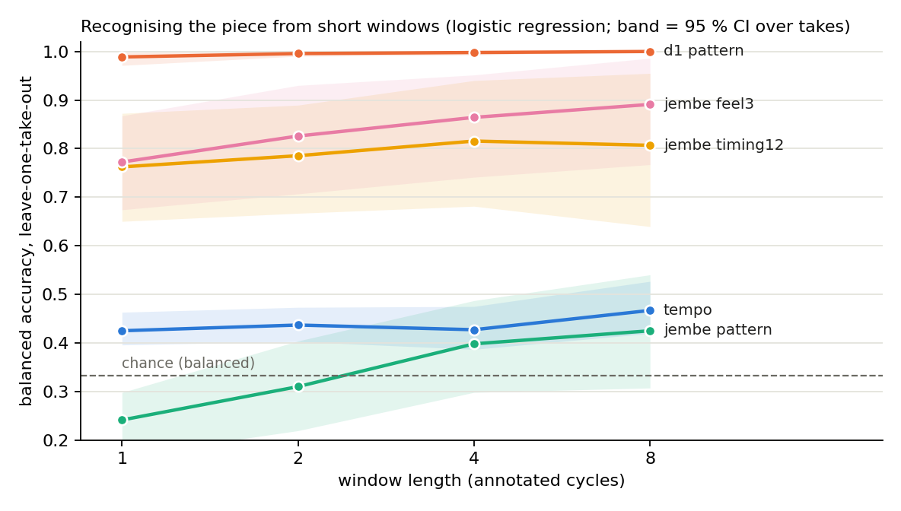
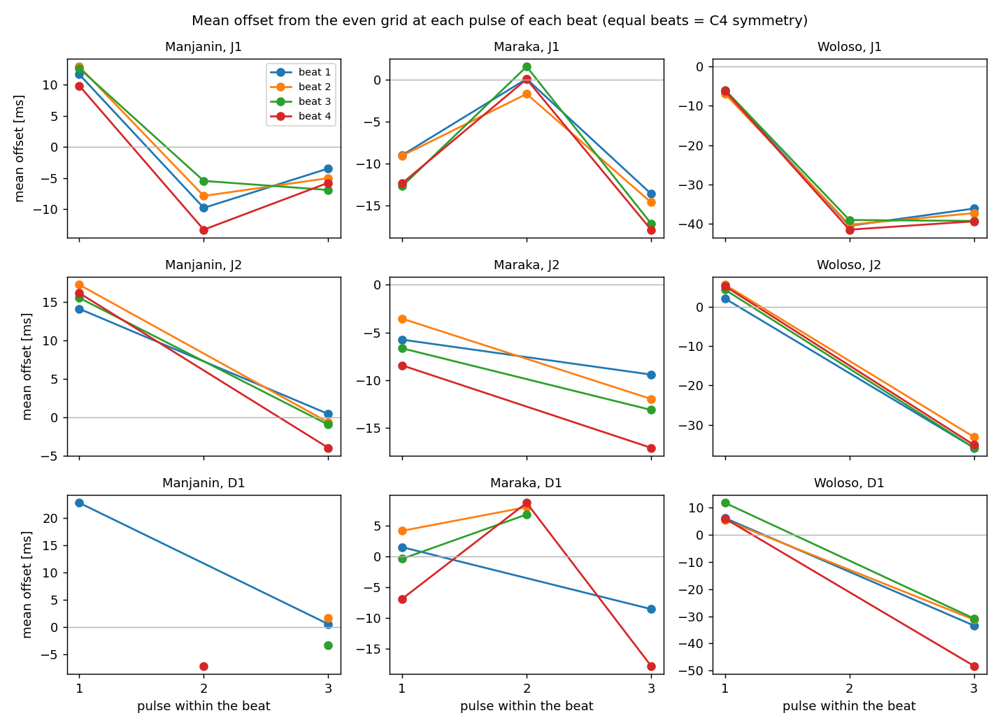
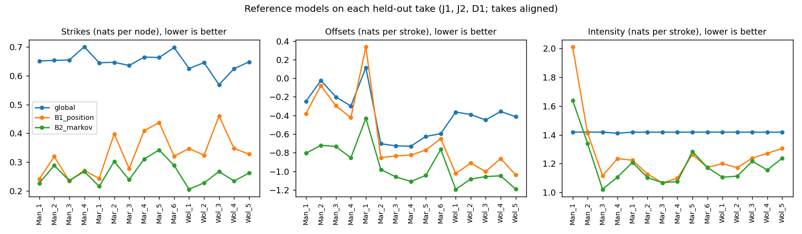
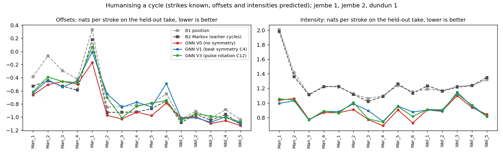
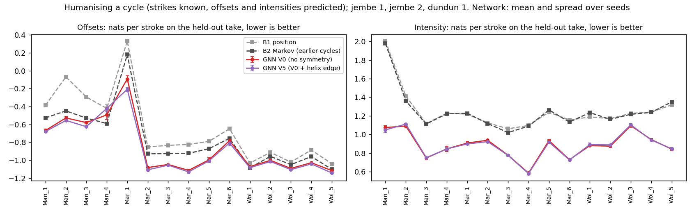
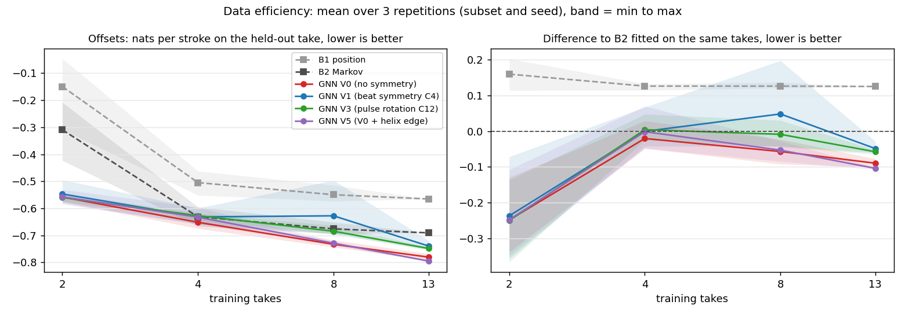

# Results and commands

All scores are leave-one-take-out over the 15 takes.

## Recognition (balanced accuracy)

| What | Result | Source |
|---|---|---|
| Piece from the whole-take dundun pattern | 15/15 takes for random forest and nearest centroid (exact 95 % CI 0.78 to 1.00) | [`step0_rf.json`](../results/step0_rf.json) |
| Piece from one cycle of dundun pattern | 0.99 (logistic regression) | [`a2_recognition.json`](../results/a2_recognition.json) |
| Piece from jembe timing only, pattern masked, 4 cycles | 0.86 (95 % CI 0.74 to 0.95) | [`a2_recognition.json`](../results/a2_recognition.json) |
| Same, restricted to the tempo range shared by all pieces | 0.87; tempo alone drops to 0.29 (logistic regression) and 0.44 (nearest centroid) | [`a2_tempo_control.json`](../results/a2_tempo_control.json) |
| Same, tempo regressed out of every feature | 0.78 (95 % CI 0.64 to 0.90) | [`a2_tempo_control.json`](../results/a2_tempo_control.json) |
| 1D CNN on jembe stroke sequences, 1 / 8 cycles, mean of 3 seeds | 0.78 / 0.74, against 0.77 / 0.89 for logistic regression on the jembe feel | [`a3_sequence_cnn_cpu.json`](../results/a3_sequence_cnn_cpu.json) |



## Beat symmetry

Feel: spread of the beat-averaged offset profile over the three pulses. Breach: how much the four beats differ at the same position. Noise floor from random beat rotation: 0.5 to 1.0 ms.

| Piece, drum | Strokes (takes) | Feel | Breach | Breach / feel |
|---|---|---|---|---|
| Manjanin, jembe 1 | 5,215 (4) | 8.7 ms | 1.8 ms | 0.21 |
| Manjanin, jembe 2 | 4,440 (3) | 8.3 ms | 1.4 ms | 0.16 |
| Maraka, jembe 1 | 4,812 (6) | 6.5 ms | 1.5 ms | 0.23 |
| Maraka, jembe 2 | 4,092 (5) | 3.3 ms | 2.2 ms | 0.66 |
| Woloso, jembe 1 | 4,389 (5) | 15.3 ms | 0.8 ms | 0.05 |
| Woloso, jembe 2 | 3,098 (4) | 19.5 ms | 1.2 ms | 0.06 |
| Woloso, dundun 1 | 2,313 (5) | 21.6 ms | 5.4 ms | 0.25 |
| Maraka, dundun 1 | 3,495 (6) | one shared position | 3.8 ms | – |



Source: [`j1_beat_symmetry.json`](../results/j1_beat_symmetry.json).

## Reference models (negative log-likelihood, nats)

Jembe 1, jembe 2, dundun 1. Histogram intersection and error of the mean as in Mishra et al. (2025). Each take's median offset is removed.

| Model | Strikes | Offsets | Intensity | Histogram intersection | Error of the mean |
|---|---|---|---|---|---|
| Global | 0.655 | −0.367 | 1.417 | 0.61 | 11.6 ms |
| B1 position | 0.311 | −0.577 | 1.300 | 0.73 | 4.6 ms |
| B2 Markov | 0.256 | −0.900 | 1.206 | 0.73 | 5.0 ms |



Source: [`j2_baselines.json`](../results/j2_baselines.json).

## Humanizing a cycle, first run (J3)

| Model | Offsets, 3 seeds (Colab) | Offsets, seed 0 (laptop) | Intensity, 3 seeds |
|---|---|---|---|
| B1 position | −0.579 | −0.579 | 1.294 |
| B2 Markov, earlier cycles | −0.709 | −0.709 | 1.286 |
| GNN V0, no symmetry | −0.709 | −0.758 | 0.907 |
| GNN V1, beat symmetry (C4) | −0.674 | −0.670 | 0.904 |
| GNN V3, pulse rotation (C12) | −0.659 | −0.687 | 0.918 |



Sources: [`j3_humanize_3seeds_colab.json`](../results/j3_humanize_3seeds_colab.json) (rebuilt from [`j3_wandb_export.csv`](../results/j3_wandb_export.csv) with [`fetch_wandb.py`](../experiments/gnn/fetch_wandb.py)), [`j3_humanize_seed0_cpu.json`](../results/j3_humanize_seed0_cpu.json), Colab rerun [`j3_rerun_wandb_export.csv`](../results/j3_rerun_wandb_export.csv). The three fixes: [`j3b_humanize_seed0_cpu.json`](../results/j3b_humanize_seed0_cpu.json).

## Humanizing a cycle, three fixes and three seeds (J3b)

Fixes: keep the last epoch (`--select last`), helix edge (V5), correction to B1 (V4, dropped after seed 0). V0 and V5 then ran with three seeds on Savio, one SLURM task per (take, seed).

| Model | Offsets, 3 seeds (Savio) | Offsets, seed 0 (laptop) | Intensity, 3 seeds | Offsets vs B2, per take |
|---|---|---|---|---|
| B1 position | −0.579 | −0.579 | 1.294 | |
| B2 Markov, earlier cycles | −0.709 | −0.709 | 1.286 | |
| GNN V0, last epoch | −0.780 | −0.784 | 0.886 | better on 13 of 15 (Wilcoxon p = 0.003) |
| GNN V5, last epoch + helix | −0.796 | −0.801 | 0.884 | better on 13 of 15 (Wilcoxon p = 0.005, sign test p = 0.007) |
| GNN V4, V5 + correction to B1 | | −0.652 | | better on 11 of 15 (seed 0) |

- Per-take tests on the seed mean of each take, two-sided. V5 against V0: better on 14 of 15, −0.020 (Wilcoxon p = 0.007).
- Seeds: V5 overall −0.791 / −0.805 / −0.793; each seed beats B2 on 13, 13 and 14 takes; the per-take standard deviation across seeds has a median of 0.013 nats (max 0.046).
- Exceptions: Woloso_1 ties B2 (−1.085 against −1.086); Manjanin_4 loses on all three seeds (V5 −0.421, V0 −0.494, B2 −0.590).
- Reproducibility: B1 and B2 are identical on Savio and on the laptop; seed 0 of the network differs by 0.016 (V0) and 0.019 (V5) per take on average, 0.12 at most.



Sources: [`j3b_humanize_3seeds_savio.json`](../results/j3b_humanize_3seeds_savio.json) (45 parts merged with [`merge_results.py`](../experiments/gnn/merge_results.py)), [`j3b_humanize_seed0_cpu.json`](../results/j3b_humanize_seed0_cpu.json).

## Data-efficiency curve (J4)

Every variant trained on 2, 4, 8 and 13 takes, B1 and B2 fitted on the same takes; nested subsets (round robin across pieces, the test piece first), 3 repetitions varying subset and seed, `--select last`. 180 Savio tasks ([`train_curve.py`](../experiments/gnn/train_curve.py)).

| Training takes | B1 | B2 | V0 | V1 (C4) | V3 (C12) | V5 (helix) |
|---|---|---|---|---|---|---|
| 2 | −0.150 | −0.310 | −0.558 | −0.547 | −0.560 | −0.558 |
| 4 | −0.505 | −0.631 | −0.652 | −0.632 | −0.627 | −0.633 |
| 8 | −0.550 | −0.676 | −0.733 | −0.628 | −0.685 | −0.729 |
| 13 | −0.565 | −0.691 | −0.780 | −0.739 | −0.748 | −0.795 |

Per-take tests on the mean of the 3 repetitions, two-sided Wilcoxon; "wins" = takes where the first model scores lower:

| Training takes | V0 vs B2 | V1 vs V0 | V3 vs V0 | V5 vs V0 |
|---|---|---|---|---|
| 2 | 11/15, −0.276, p = 0.003 | 9/15, +0.005, p = 0.89 | 8/15, +0.010, p = 0.89 | 8/15, −0.002, p = 0.98 |
| 4 | 12/15, −0.039, p = 0.015 | 4/15, +0.016, p = 0.035 | 3/15, +0.031, p = 0.022 | 6/15, +0.009, p = 0.85 |
| 8 | 14/15, −0.066, p = 0.007 | 1/15, +0.076, p < 0.001 | 0/15, +0.047, p < 0.001 | 12/15, −0.002, p = 0.11 |
| 13 | 14/15, −0.094, p = 0.001 | 1/15, +0.041, p < 0.001 | 3/15, +0.037, p = 0.008 | 12/15, −0.017, p = 0.012 |

- Spread over repetitions (overall score, min to max): within 0.04 for V0 and V3 at every size; up to 0.085 for V1 and V5 with 2 and 4 takes; V1 at 8 takes spans −0.693 to −0.496 because one run diverged (Manjanin_4, repetition 2, +1.245 against about −0.4 for the other two).
- B2 is fitted per piece, so with 2 takes it sees one take of the test piece; the network pools all takes, which accounts for part of its lead at that size.



Source: [`j4_curve_savio.json`](../results/j4_curve_savio.json) (180 parts merged with [`merge_results.py`](../experiments/gnn/merge_results.py)).

## Commands

```bash
pip install -e ".[dev]"
python -m djembe.dataset download     # annotations only, about 10 MB from OSF
python -m djembe.dataset build        # output/events.csv, about 7 s
python -m djembe.dataset splits       # regenerates splits.json (deterministic)
python -m djembe.dataset pack         # optional: output/djembe_corpus.zip, a private backup of the annotations
python -m pytest -q                   # a few seconds
python experiments/recognition/step0_rf_baseline.py      # results/step0_rf.json, about 20 s
python experiments/recognition/recognition_baselines.py  # results/a2_recognition.json and figure, several minutes
python experiments/recognition/tempo_control.py          # results/a2_tempo_control.json, a few minutes
python experiments/recognition/sequence_models.py --models cnn --out results/a3_sequence_cnn_cpu.json   # about 20 min on 2 threads
python experiments/recognition/make_figures.py           # docs/figures/
python experiments/symmetry/beat_symmetry.py             # results/j1_beat_symmetry.json and figure, a few minutes
python experiments/baselines/run_baselines.py            # results/j2_baselines.json and figure, a few minutes
python experiments/gnn/train_humanize.py --variants V0 V1 V3 --seeds 0 --out results/j3_humanize_seed0_cpu.json   # about 1.5 h on a laptop CPU
python experiments/gnn/train_humanize.py --variants V0 V4 V5 --seeds 0 --select last --out results/j3b_humanize_seed0_cpu.json   # about 2 h in 4 parallel parts (--takes)
sbatch -A <account> --array=0-44 --time=00:30:00 savio/j3b_array.sbatch   # on Savio: V0 and V5, 15 takes x 3 seeds, about 5 min per task (savio/README.md)
python experiments/gnn/merge_results.py <run dir>/part_*.json --out results/j3b_humanize_3seeds_savio.json --expect-takes 15 --expect-seeds 3
python experiments/gnn/plot_humanize.py results/j3b_humanize_3seeds_savio.json docs/figures/j3b_humanize_3seeds_savio.png
sbatch -A <account> --array=0-179 savio/curve_array.sbatch   # on Savio: data-efficiency curve, V0 V1 V3 V5 on 2, 4, 8, 13 takes x 3 repetitions
python experiments/gnn/merge_results.py <run dir>/part_*.json --out results/j4_curve_savio.json --expect-takes 15 --expect-seeds 3
python experiments/gnn/plot_curve.py results/j4_curve_savio.json docs/figures/j4_curve.png
DJEMBE_VENV=$HOME/envs/djembe DJEMBE_OUT=$HOME/djembe_runs sbatch -A <account> --array=0-44 savio/gen_array.sbatch   # J5 generation, see savio/README.md
python experiments/generation/generate_eval.py --takes Woloso_5 --seeds 0 --epochs 2   # quick local check, about a minute
DJEMBE_VENV=$HOME/envs/djembe DJEMBE_OUT=$HOME/djembe_runs sbatch -A <account> --array=0-44 savio/solo_array.sbatch   # J5b soloist over the real ensemble
python experiments/generation/solo_eval.py --takes Woloso_5 --seeds 0 --epochs 2   # quick local check
```
